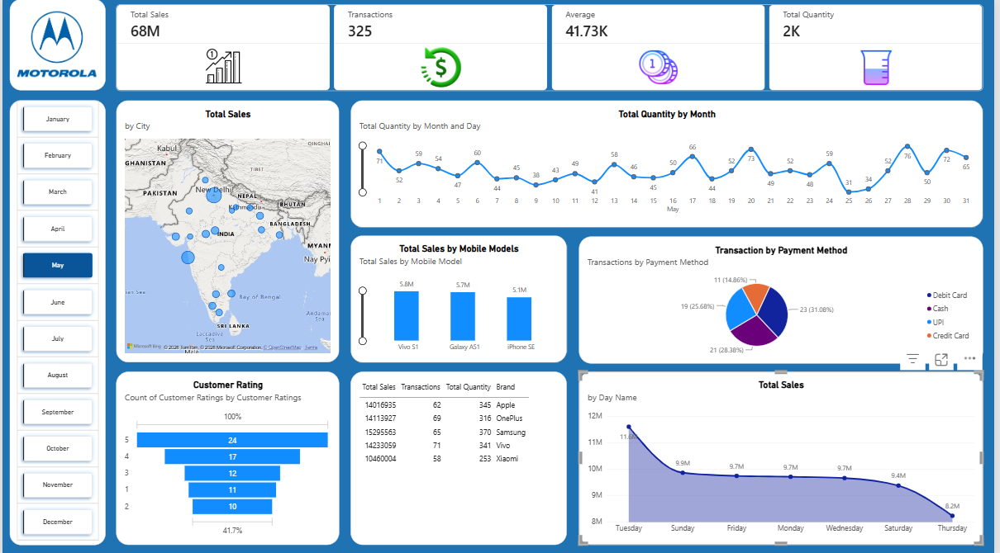

# 📊 Motorola Sales & Analytics Dashboard | Power BI

## 📌 Project Overview

The **Motorola Sales & Analytics Dashboard** is an interactive business intelligence project developed using Microsoft Power BI to analyze sales performance, customer satisfaction, transaction trends, and product popularity. The dashboard transforms raw sales data into meaningful visual insights that help identify business trends, evaluate product performance, and support data-driven decision-making.

It provides a comprehensive overview of key performance indicators (KPIs), city-wise sales distribution, payment preferences, brand comparisons, and daily and monthly sales trends through interactive visualizations and filters.

## 🎯 Key Features

- **Sales Performance Analysis:** Monitor total sales, transaction value, quantity sold, and transaction volume.
- **Geographical Sales Analysis:** Visualize city-wise sales distribution to identify key markets.
- **Product Performance:** Compare mobile models based on sales and popularity.
- **Payment Method Analysis:** Analyze customer payment preferences, including Debit Card, Credit Card, Cash, and UPI.
- **Customer Satisfaction:** Evaluate customer ratings to understand satisfaction levels.
- **Brand Comparison:** Compare Apple, Samsung, Vivo, OnePlus, and Xiaomi based on sales, transactions, and quantity sold.
- **Sales Trend Analysis:** Identify sales patterns across different days and months.
- **Interactive Dashboard:** Use slicers and filters to explore data by month, brand, and mobile model.

## 📈 Key Performance Indicators (KPIs)

| Metric | Value |
|---|---:|
| Total Sales | 68M |
| Total Transactions | 325 |
| Average Transaction Value | 41.73K |
| Total Quantity Sold | 2K |

## 🛠️ Tools & Technologies

- **Microsoft Power BI** – Interactive dashboard development
- **Power Query** – Data cleaning and transformation
- **DAX (Data Analysis Expressions)** – KPI calculations and analytical measures
- **Data Visualization** – Charts, maps, tables, and interactive reports
- **Business Intelligence** – Sales reporting and performance analysis

## 💡 Business Insights

This dashboard helps users understand:

- Which mobile models and brands contribute most to sales.
- Which cities generate higher sales.
- How customers prefer to pay for their purchases.
- How sales performance changes across days and months.
- What customer ratings reveal about the shopping experience.

## 🚀 Project Objective

The main objective of this project is to demonstrate practical skills in **Power BI, data visualization, data analysis, KPI reporting, and business intelligence** by converting sales data into an interactive and easy-to-understand dashboard.

## 👨‍💻 Skills Demonstrated

`Power BI` `DAX` `Power Query` `Data Cleaning` `Data Visualization` `Business Intelligence` `Sales Analytics` `KPI Analysis`

---

**⭐ If you find this project useful, consider giving this repository a star!**

## 📷 Screenshots / Demos

